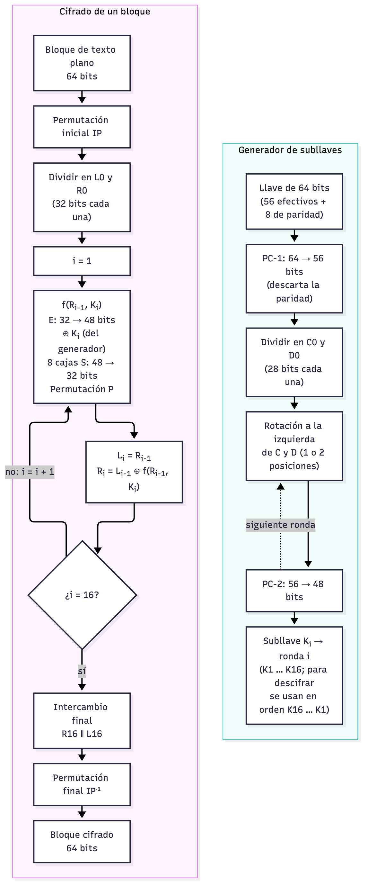
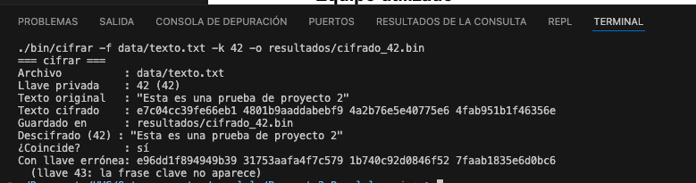

# Parte A.1 y A.2 · El algoritmo DES

## A.1 ¿Qué es DES?

El *Data Encryption Standard* (DES) es un algoritmo de cifrado **simétrico por bloques**:
la misma llave sirve para cifrar y para descifrar. Fue publicado como estándar federal de
Estados Unidos en 1977 (FIPS PUB 46), a partir del cifrado *Lucifer* de IBM, y su última
revisión es la FIPS PUB 46-3 de 1999 [1]. El NIST lo retiró en 2005 porque su llave es
demasiado corta para la capacidad de cómputo actual [2].

| Característica | Valor |
|---|---|
| Tamaño de bloque | 64 bits (8 bytes) |
| Tamaño de llave | 64 bits, de los cuales 8 son de paridad: **56 bits efectivos** |
| Espacio de llaves | 2^56 = 72 057 594 037 927 936 ≈ 7.2 · 10^16 |
| Estructura | Red de Feistel de **16 rondas** |
| Subllaves | 16 subllaves de 48 bits, una por ronda |

El último bit de cada uno de los 8 bytes de la llave es de paridad impar y no interviene en
el cifrado. Por eso, aunque la llave ocupa 64 bits, la búsqueda por fuerza bruta solo tiene
que recorrer 2^56 combinaciones.

### Cifrar, paso a paso

1. **Permutación inicial (IP).** Los 64 bits del bloque se reordenan según una tabla fija.
2. **División.** El resultado se parte en dos mitades de 32 bits: L₀ (izquierda) y R₀ (derecha).
3. **16 rondas de Feistel.** Para i = 1, …, 16:

   L_i = R_{i−1}
   R_i = L_{i−1} ⊕ f(R_{i−1}, K_i)

   Solo la mitad derecha pasa por la función f; la izquierda solo se combina con XOR.
4. **Intercambio final.** Tras la ronda 16 se intercambian las mitades: el bloque queda R₁₆ ‖ L₁₆.
5. **Permutación final (IP⁻¹).** Es la inversa de IP y da el bloque cifrado de 64 bits.

### La función f

La función f(R, K) recibe 32 bits de la mitad derecha y 48 bits de la subllave [1], [3]:

1. **Expansión E:** de 32 a 48 bits, duplicando 16 de los bits de entrada.
2. **XOR** con la subllave K_i de 48 bits.
3. **Cajas S (S-boxes):** los 48 bits se parten en 8 grupos de 6. Cada caja S_j convierte
   6 bits en 4 mediante una tabla de búsqueda: los bits de los extremos eligen la fila y
   los 4 centrales la columna. Salen 32 bits. Es la única parte **no lineal** de DES y la
   que le da su seguridad.
4. **Permutación P:** reordena los 32 bits resultantes.

### Generación de subllaves

1. **PC-1** (*Permuted Choice 1*): toma la llave de 64 bits, descarta los 8 bits de paridad
   y reordena los 56 restantes.
2. Los 56 bits se dividen en dos mitades de 28 bits, C₀ y D₀.
3. En cada ronda, C y D se **rotan a la izquierda** 1 posición (rondas 1, 2, 9 y 16) o
   2 posiciones (las demás). En total suman 28 posiciones, así que al final vuelven al inicio.
4. **PC-2** (*Permuted Choice 2*): de los 56 bits de C_i ‖ D_i se eligen 48, que forman K_i.

### Descifrar

Por la estructura de Feistel, **descifrar es el mismo algoritmo** con las subllaves en orden
inverso (K₁₆, K₁₅, …, K₁). La función f no tiene que ser invertible: cada ronda se deshace
aplicando el mismo XOR otra vez [3].

### Modo ECB y relleno

DES cifra un bloque de 8 bytes. Para textos más largos usamos el modo **ECB** (*Electronic
Codebook*): cada bloque se cifra por separado con la misma llave. Nuestro texto,
`"Esta es una prueba de proyecto 2"`, mide 32 bytes, es decir, 4 bloques exactos. Si no fuera
múltiplo de 8, el último bloque se **rellena con ceros** (función `padded_length`).

ECB **no es seguro** para mensajes reales: dos bloques de texto plano iguales producen dos
bloques cifrados iguales, así que se filtran patrones del mensaje. Los modos encadenados como
CBC o CTR lo evitan [3]. Para este proyecto no importa, porque lo que se ataca es la llave.

### DES ante la fuerza bruta

Con 56 bits efectivos, DES quedó al alcance del *hardware* dedicado a finales de los noventa:

- En 1998, la máquina **Deep Crack** de la Electronic Frontier Foundation (EFF), que costó unos
  250 000 dólares, recuperó una llave DES en **56 horas** [4].
- En enero de 1999, el **DES Challenge III**, de la EFF junto con distributed.net, lo logró en
  **22 horas y 15 minutos** [4].

Nuestro programa secuencial prueba unos **3.9 · 10^6 llaves por segundo** (medido en la Mac de
Nico, ver `resultados/secuencial_longitudes.csv`). Recorrer las 2^56 llaves tomaría
7.2 · 10^16 / 3.9 · 10^6 ≈ 1.85 · 10^10 s, unos **585 años** (en promedio, la mitad). Por eso
el proyecto paraleliza la búsqueda y, para medir, reduce el espacio con `-b`.

## A.2 Diagrama de flujo

*Figura 1.* Cifrado de un bloque con DES (izquierda) y generación de las 16 subllaves (derecha).
Fuente del diagrama: `docs/img/des-flujo.mmd` (Mermaid).

## B.1 Verificación del cifrado

El programa `cifrar` (Parte B.1) cifra el texto con la llave 42 y lo descifra de vuelta:

El cifrado obtenido, `e7c04cc39fe66eb1 4801b9aaddabebf9 4a2b76e5e40775e6 4fab951b1f46356e`,
coincide con el de `openssl enc -des-ecb` con la misma llave. Con la llave vecina, 43, sale
basura y la frase clave no aparece.

## Referencias

[1] National Institute of Standards and Technology, *FIPS PUB 46-3: Data Encryption Standard
(DES)*, Gaithersburg, MD, EE. UU., 1999.

[2] National Institute of Standards and Technology, «Announcing Approval of the Withdrawal of
Federal Information Processing Standard (FIPS) 46-3, Data Encryption Standard (DES)», *Federal
Register*, vol. 70, n.º 96, pp. 28907–28908, 19 de mayo de 2005.

[3] W. Stallings, *Cryptography and Network Security: Principles and Practice*, 8.ª ed.
Hoboken, NJ, EE. UU.: Pearson, 2020.

[4] Electronic Frontier Foundation, *Cracking DES: Secrets of Encryption Research, Wiretap
Politics & Chip Design*. Sebastopol, CA, EE. UU.: O'Reilly, 1998; y EFF, «EFF DES Cracker
Machine Brings Honesty to Crypto Debate», comunicado del 19 de enero de 1999.
