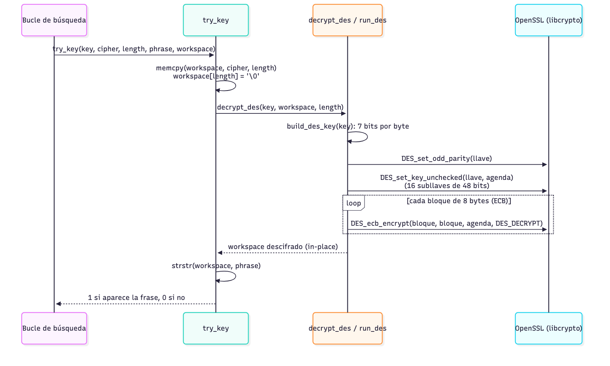
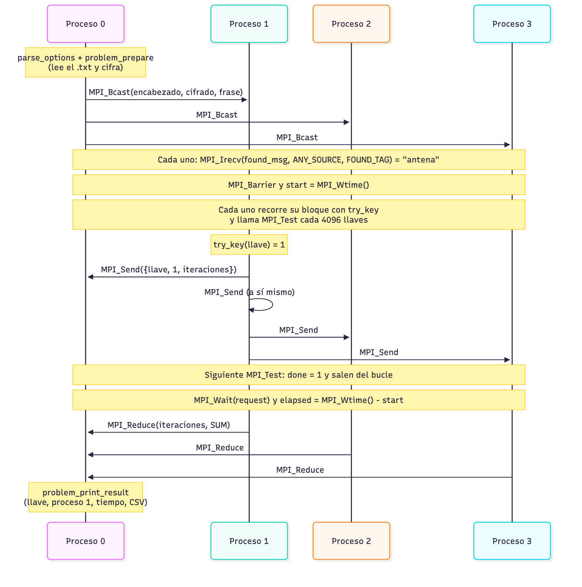

# Parte A.4 a A.6 · Rutinas de la base y primitivas MPI

## A.4 Por qué no compila `rpc/des_crypt.h` y cómo lo reemplazamos

El `bruteforce.c` del curso incluye `<rpc/des_crypt.h>` y usa `ecb_crypt` y `des_setparity`.
Esas funciones eran parte de la implementación de **Sun RPC** que venía dentro de la
biblioteca de C de GNU (glibc). glibc la fue retirando por pasos [1], [2]:

- **glibc 2.26 (2017)** dejó de instalar por defecto las cabeceras de Sun RPC; solo se
  instalaban si glibc se compilaba con `--enable-obsolete-rpc`. Varias distribuciones, como
  Fedora 28, las quitaron entonces.
- **glibc 2.32 (2020)** eliminó por completo Sun RPC, la opción `--enable-obsolete-rpc`,
  `rpcgen` y sus cabeceras. Lo recomendado desde entonces es la biblioteca externa
  **libtirpc**, que no viene instalada por defecto.

El motivo fue que esa implementación no soportaba IPv6 y arreglarlo exigía romper la ABI [1].
Por eso, en una distribución moderna (Ubuntu 22.04 o más nuevo, Arch, Fedora) `#include
<rpc/des_crypt.h>` falla con «No such file or directory». En macOS tampoco existe.

En lugar de depender de libtirpc, usamos la API DES de **OpenSSL** (`<openssl/des.h>`, enlazada
con `-lcrypto`), que está en cualquier sistema y además permite verificar el resultado con la
herramienta `openssl enc -des-ecb` [3]. OpenSSL 3 marca esa API como obsoleta porque DES ya no
es seguro, pero la mantiene; el aviso se apaga con `-DOPENSSL_SUPPRESS_DEPRECATED`. El módulo
`des_utils` reemplaza a las rutinas originales:

| `bruteforce.c` (Sun RPC) | Nuestro proyecto (OpenSSL) |
|---|---|
| `encrypt(key, ciph, len)` | `encrypt_des(key, buffer, length)` |
| `decrypt(key, ciph, len)` | `decrypt_des(key, buffer, length)` |
| `tryKey(key, ciph, len)` | `try_key(key, cipher, length, phrase, workspace)` |
| `des_setparity(k)` | `DES_set_odd_parity(&k)` |
| `ecb_crypt(k, buf, len, DES_ENCRYPT)` | `DES_set_key_unchecked` + `DES_ecb_encrypt` por bloque |

## A.5 Las rutinas, una por una

### `encrypt_des` y `decrypt_des`

Ambas llaman a la misma función interna, `run_des`, y solo cambian la dirección
(`DES_ENCRYPT` o `DES_DECRYPT`). Trabajan *in-place*: el resultado sobrescribe el buffer.

1. **Armar la llave (`build_des_key`).** La llave es un número de 56 bits, pero DES pide 8 bytes
   en los que el bit menos significativo de cada uno es de paridad. Igual que el `decrypt()`
   original, los 56 bits se reparten en grupos de 7: el byte *i* guarda los bits 7*i* a 7*i*+6 de
   la llave en sus posiciones 1 a 7, y `DES_set_odd_parity` llena la posición 0 para que cada
   byte tenga paridad impar.
2. **Agenda de subllaves.** `DES_set_key_unchecked` calcula las 16 subllaves de 48 bits (PC-1,
   rotaciones y PC-2, ver la Parte A.1). Usamos la versión *unchecked* porque la normal rechaza
   las llaves débiles de DES, y en una búsqueda por fuerza bruta hay que probarlas todas.
3. **ECB bloque a bloque.** `DES_ecb_encrypt` procesa cada bloque de 8 bytes por separado con
   la misma agenda. La longitud siempre es múltiplo de 8 gracias al relleno con ceros.

### `try_key`

Es el corazón de la búsqueda: prueba una llave candidata.

1. Copia el cifrado al buffer `workspace` con `memcpy`.
2. Le pone un `'\0'` al final para poder tratarlo como cadena de C.
3. Lo descifra con la llave candidata (`decrypt_des`).
4. Busca la frase clave con `strstr`. Si aparece, la llave es la correcta (o, con muy poca
   probabilidad, un falso positivo, que el reporte marca).

El `workspace` lo reserva **una sola vez** quien llama, en lugar de pedir memoria en cada
intento como hacía el original. Así se evitan millones de `malloc` y `free`.

### `memcpy`

`memcpy(destino, origen, n)` copia `n` bytes de un buffer a otro. Aquí es indispensable porque
`decrypt_des` descifra *in-place*: si descifráramos directamente el cifrado original, el
primer intento fallido lo destruiría y ya no habría nada que probar con la siguiente llave. Con
la copia, el cifrado original queda intacto durante toda la búsqueda [4].

### `strstr`

`strstr(texto, frase)` devuelve un puntero a la primera aparición de `frase` dentro de `texto`,
o `NULL` si no aparece [4]. Es la prueba de que la llave es correcta: con una llave errónea, el
descifrado es basura y la frase no aparece. Por eso el texto debe terminar en `'\0'` y por eso
`problem_prepare` rechaza de entrada una frase que no esté en el texto original.

### Un intento de llave, en secuencia



*Figura 2.* Lo que ocurre en cada llamada a `try_key`.

## A.6 Primitivas MPI del aviso de llave

| Primitiva | Tipo | Para qué la usamos |
|---|---|---|
| `MPI_Irecv` | No bloqueante | Dejar puesta una «antena» que reciba el aviso de llave encontrada |
| `MPI_Send` | Bloqueante | Que quien halla la llave avise a todos los procesos |
| `MPI_Wait` | Bloqueante | Cerrar la recepción pendiente antes de terminar |
| `MPI_Test` | No bloqueante | Revisar, sin detenerse, si ya llegó el aviso |

### `MPI_Irecv`

`MPI_Irecv(buf, count, datatype, source, tag, comm, &request)` **inicia** una recepción y
regresa de inmediato, sin esperar a que llegue el mensaje [5]. Devuelve un `MPI_Request` con el
que después se consulta o se espera. En el naive, cada proceso, antes de buscar, publica:

```c
MPI_Irecv(found_msg, 3, MPI_UINT64_T, MPI_ANY_SOURCE, FOUND_TAG, MPI_COMM_WORLD, &request);
```

`MPI_ANY_SOURCE` permite recibir el aviso venga de quien venga, y `found_msg` guarda
`{llave, proceso que la halló, sus iteraciones}`. Mientras tanto, el proceso sigue probando
llaves: por eso es la «antena».

### `MPI_Send`

`MPI_Send(buf, count, datatype, dest, tag, comm)` envía un mensaje y no regresa hasta que el
buffer se puede reutilizar [5]. El proceso que encuentra la llave envía el aviso a **todos**,
**incluido él mismo**, para que su propio `MPI_Irecv` también se complete y todos cierren igual.
Como el mensaje es de solo 24 bytes y cada destino ya tiene su recepción publicada, el envío
termina casi de inmediato.

### `MPI_Wait`

`MPI_Wait(&request, &status)` bloquea hasta que la operación no bloqueante asociada termina [5].
Al salir del bucle, todos los procesos hacen `MPI_Wait` sobre su antena: así garantizan que
`found_msg` ya tiene el aviso antes de usarlo y que no queda ninguna operación pendiente al
llamar a `MPI_Finalize`. Si el proceso agotó su bloque sin hallar nada, `MPI_Wait` lo deja
esperando hasta que otro avise.

### ¿Por qué hace falta `MPI_Test`?

El `bruteforce.c` original revisa una variable `found` en cada vuelta, pero esa variable solo
cambia si la biblioteca MPI **avanza** la recepción. Open MPI, por defecto, no tiene un hilo que
procese mensajes en segundo plano: el progreso de las comunicaciones solo ocurre **dentro de
llamadas a MPI** [5]. Un proceso que solo ejecuta `try_key` nunca entra a MPI, así que el aviso
se queda en el sistema sin entregarse y el proceso termina su bloque completo.

Por eso, cada `POLL_INTERVAL` = 4096 llaves, el naive llama
`MPI_Test(&request, &done, MPI_STATUS_IGNORE)`: le da a MPI la oportunidad de avanzar y, si el
aviso ya llegó, `done` vale 1 y el proceso sale del bucle. Probar 4096 llaves toma alrededor de
1 ms, así que el costo de la revisión es despreciable y el retraso máximo para enterarse es de
ese orden.

### Flujo de mensajes del naive con 4 procesos



*Figura 3.* El proceso 1 encuentra la llave: envía el aviso a los 4 procesos, cada uno lo
detecta en su siguiente `MPI_Test`, cierra con `MPI_Wait` y el proceso 0 reúne las iteraciones
con `MPI_Reduce` y reporta el resultado.

Además del aviso, el naive usa `MPI_Bcast` para repartir el problema (solo el proceso 0 lee el
archivo y cifra), `MPI_Barrier` para que todos arranquen el reloj (`MPI_Wtime`) a la vez y
`MPI_Reduce` para sumar las llaves probadas. Cuando hay límite de tiempo (`-t`), el proceso 0
envía el mismo aviso con la llave imposible `UINT64_MAX`, que el reporte traduce a «no
encontrada».

## Referencias

[1] Fedora Project, «Changes/SunRPCRemoval: Removal of Sun RPC Interfaces From glibc», *Fedora
Project Wiki*, 2018. Disponible: https://fedoraproject.org/wiki/Changes/SunRPCRemoval

[2] The GNU C Library, «NEWS: Version 2.26» y «NEWS: Version 2.32», Free Software Foundation,
2017 y 2020.

[3] OpenSSL Project, «DES_random_key, DES_set_key, DES_ecb_encrypt…: DES encryption», *OpenSSL 3
Manual Pages*. Disponible: https://docs.openssl.org/3.0/man3/DES_random_key/

[4] ISO/IEC 9899:2011, *Programming languages — C*, secciones 7.24.2.1 (`memcpy`) y 7.24.5.7
(`strstr`), 2011.

[5] Message Passing Interface Forum, *MPI: A Message-Passing Interface Standard*, versión 4.1,
noviembre de 2023, capítulo 3: comunicación punto a punto (`MPI_Send`) y comunicación no
bloqueante (`MPI_Irecv`, `MPI_Wait`, `MPI_Test`).
