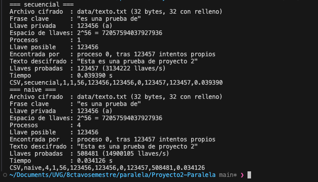
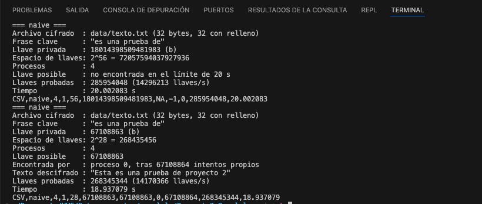
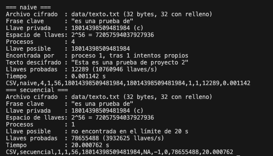

# Parte B.1 y B.2: Pruebas del cifrado y del naive

Todas las corridas de este capítulo se hicieron en la MacBook Pro de Nico: Apple M4 Pro con 8
núcleos de rendimiento y 4 de eficiencia, macOS 26.6.1, Open MPI 5.0.11 y OpenSSL 3 de
Homebrew. Se usó el texto `data/texto.txt` con la frase clave «es una prueba de». Los datos
crudos están en `resultados/pruebas_b2.csv` y los genera el script `scripts/pruebas_b2.sh`.

## B.1 Cifrar y descifrar desde un `.txt`

El programa `cifrar` carga el texto de `data/texto.txt`, lo cifra con la llave 42 que recibe
por parámetro (`-k 42`) y lo descifra de vuelta. El texto descifrado coincide con el original,
como se ve en la figura 4.

Figura 4. Cifrado y descifrado de `data/texto.txt` con la llave 42.

El cifrado, `e7c04cc39fe66eb1 4801b9aaddabebf9 4a2b76e5e40775e6 4fab951b1f46356e`, es el mismo
que produce `openssl enc -des-ecb` con esa llave. Con la llave vecina, la 43, sale basura y la
frase clave no aparece. Eso es justo lo que la búsqueda usa para distinguir la llave correcta.

## B.2 Naive con 4 procesos contra el secuencial

Las tres llaves del enunciado, con N = 2^56, caen en lugares muy distintos del reparto. Con
`-np 4`, el naive da a cada proceso un bloque contiguo de N/4 = 2^54 llaves: el proceso 0 prueba
de 0 a N/4 − 1, el proceso 1 de N/4 a N/2 − 1, y así sucesivamente.

| Prueba | Llave | Posición |
|---|---|---|
| a | 123456 | Muy al inicio del espacio, dentro del bloque del proceso 0 |
| b | N/4 − 1 = 18014398509481983 | Última llave del bloque del proceso 0 |
| c | N/4 = 18014398509481984 | Primera llave del bloque del proceso 1 |

### Resultados con 56 bits

Con 56 bits se fijó un límite de 120 s por corrida. La tabla muestra qué programa halló la llave
y en cuánto tiempo.

| Prueba | Programa | ¿La halló? | Proceso | Iteraciones | Llaves probadas | Tiempo |
|---|---|---|---|---|---|---|
| a | secuencial | sí | 0 | 123 457 | 123 457 | 0.054 s |
| a | naive -np 4 | sí | 0 | 123 457 | 492 097 | 0.034 s |
| b | secuencial | no (límite) | — | — | 459 493 376 | 120.0 s |
| b | naive -np 4 | no (límite) | — | — | 1 689 812 992 | 120.0 s |
| c | secuencial | no (límite) | — | — | 433 438 720 | 120.0 s |
| c | naive -np 4 | sí | 1 | 1 | 12 289 | 0.0012 s |

La prueba a es tan corta que la primera corrida tiene ruido de arranque. Repetida 5 veces, la
mediana es 0.032 s para el secuencial y 0.034 s para el naive.

Con 56 bits, las pruebas b y c no terminan en el secuencial, así que su tiempo se estima. En la
corrida de 120 s el secuencial probó r_s ≈ 3.83·10^6 llaves/s. Para b, T_s ≈ 2^54 / r_s ≈
4.70·10^9 s, unos 149 años. Para c el cálculo es prácticamente el mismo.

En el naive, la llave b es la última del bloque del proceso 0, que la alcanza tras 2^54
intentos. Cada proceso probó unas 3.52·10^6 llaves/s (1 689 812 992 / 4 / 120 s). Entonces
T_p(b) ≈ 2^54 / 3.52·10^6 ≈ 5.1·10^9 s, unos 162 años.

### Resultados con 28 bits

Con `-b 28` los presets escalan (b = 2^26 − 1 y c = 2^26) y conservan su posición relativa. La
llave b sigue siendo la última del proceso 0 y la c, la primera del proceso 1.

| Prueba | Programa | Proceso | Iteraciones | Tiempo |
|---|---|---|---|---|
| b | secuencial | 0 | 67 108 864 | 18.20 s |
| b | naive -np 4 | 0 | 67 108 864 | 19.00 s |
| c | secuencial | 0 | 67 108 865 | 18.56 s |
| c | naive -np 4 | 1 | 1 | 0.0012 s |

### Speedup

El speedup es S = T_s / T_p. Además reportamos el speedup de rendimiento, S_rend, que divide las
llaves por segundo del naive entre las del secuencial. Ese segundo valor mide cuánto trabajo
útil hacen los 4 procesos juntos, sin importar dónde cae la llave.

| Prueba | T_s | T_p (naive -np 4) | S = T_s / T_p | Comentario |
|---|---|---|---|---|
| a · 56 bits | 0.032 s | 0.034 s | ≈ 0.9 | El proceso 0 hace el mismo trabajo que el secuencial |
| b · 56 bits | ≈ 149 años (est.) | ≈ 162 años (est.) | ≈ 0.9 | Ninguna ganancia |
| c · 56 bits | ≈ 149 años (est.) | 0.0012 s | ≈ 3.9·10^12 | Aparente: efecto de búsqueda |
| b · 28 bits | 18.20 s | 19.00 s | 0.96 | Ninguna ganancia, medido completo |
| c · 28 bits | 18.56 s | 0.0012 s | ≈ 1.6·10^4 | Aparente: efecto de búsqueda |

En la prueba b con 56 bits, los 4 procesos probaron juntos 14.1·10^6 llaves/s, contra
3.83·10^6 del secuencial. Eso da S_rend ≈ 3.7, que no pasa de p = 4. El naive sí trabaja casi
cuatro veces más rápido; lo que pasa es que en b todo ese trabajo extra se hace en bloques donde
la llave no está.

### Reflexión

El tiempo del naive no depende de cuántas llaves hay que probar en total. Depende de dónde cae
la llave dentro del bloque del proceso que la tiene: T_p ≈ (llave − inicio de su bloque + 1)
dividido entre el ritmo de un proceso.

La llave 123456 de la prueba a cae al inicio del bloque del proceso 0. Ese proceso hace los
mismos 123 457 intentos que el secuencial, y los otros tres no aportan nada. El speedup ronda 1:
paralelizar no ayudó y solo agregó el costo de arrancar MPI.

La llave de la prueba b es la última del proceso 0. Ese proceso recorre sus 2^54 llaves en unos
162 años, igual que el secuencial en 149, mientras los otros tres terminan sus bloques sin
encontrar nada. El speedup vuelve a rondar 1, o un poco menos por el costo de `MPI_Test`.

La llave de la prueba c es la primera del proceso 1, que la encuentra en un solo intento y en un
milisegundo. El secuencial tardaría 149 años, así que el speedup es de unos 4·10^12, muchísimo
mayor que p = 4.

Las llaves b y c son vecinas, pues difieren en 1. Sin embargo, una da el peor resultado posible
y la otra un speedup astronómico. Ese S > p de la llave c no es superlinealidad real: es el
efecto de búsqueda. El naive no hizo el trabajo más rápido; simplemente empezó a buscar justo
donde estaba la llave. El speedup de rendimiento, que en nuestras corridas no pasa de 3.7,
muestra lo que el paralelismo aporta de verdad.

Esto deja ver la debilidad del reparto en bloques contiguos: el resultado depende de la suerte y
no del algoritmo. Da una «falsa confianza» si se prueba con llaves al inicio de un bloque, y no
ayuda nada si la llave cae al final del primero. Los enfoques alternativos del capítulo
siguiente reparten las llaves para que todos los procesos avancen a la vez por las zonas bajas
del espacio. Así el speedup se vuelve consistente y cercano a p para cualquier llave.

### Capturas

Para las capturas, las corridas que no terminan usan un límite de 20 s en lugar de 120 s. Las
tablas anteriores salen de la corrida completa de `scripts/pruebas_b2.sh`.

Figura 5. Prueba a: el secuencial y el naive hallan la llave 123456 en el proceso 0 tras 123 457
intentos.

Figura 6. Prueba b: con 56 bits el naive no la halla en el límite; con 28 bits la halla el
proceso 0 tras recorrer su bloque completo (2^26 intentos, 18.9 s).

Figura 7. Prueba c: el proceso 1 halla la llave al primer intento (0.001 s), mientras el
secuencial no la halla en el límite.
