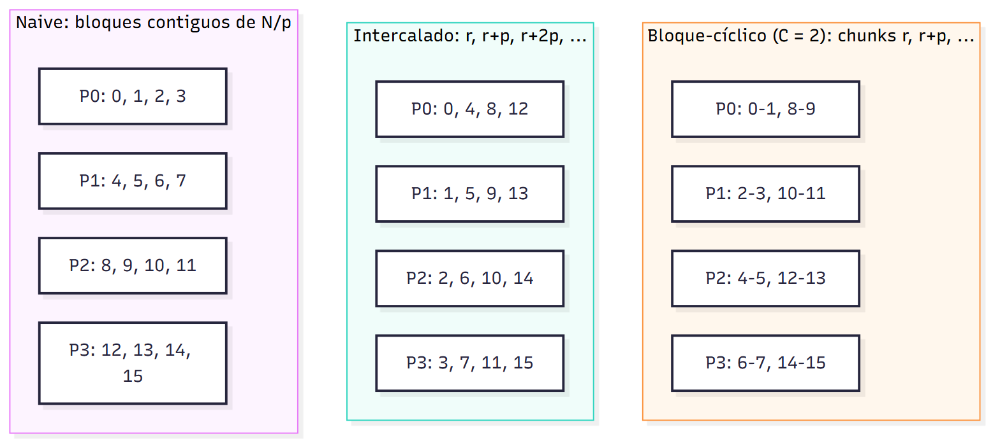
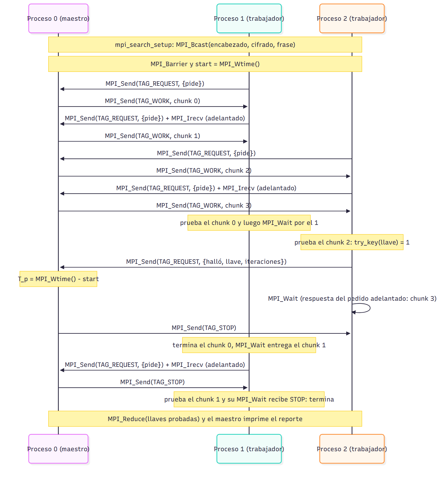
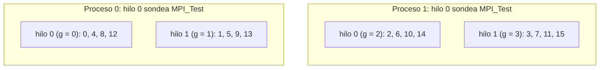

# Enfoques de paralelización

Los cinco programas MPI (y el híbrido, que añade OpenMP) resuelven el mismo problema con el mismo arranque, el mismo aviso de
llave y el mismo reporte (módulo `search_mpi`). Lo único que cambia entre ellos es **qué llaves
prueba cada proceso y en qué orden**. Este capítulo describe cada reparto, predice con una
fórmula quién halla la llave y en cuántas iteraciones, y discute qué gana y qué pierde cada uno.

## Esqueleto común

```text
proceso 0: lee parámetros y archivo, cifra el texto
MPI_Bcast(encabezado, cifrado, frase)            # errores: salen una vez y todos cierran
MPI_Irecv(aviso)                                 # la "antena", puesta antes de buscar
MPI_Barrier; inicio = MPI_Wtime()
para cada llave k del reparto de este proceso:
    cada POLL_INTERVAL = 4096 llaves: MPI_Test(antena); si llegó el aviso, salir
    si try_key(k): MPI_Send(aviso {k, rango, iteraciones}) a todos; salir
MPI_Wait(antena); T_p = MPI_Wtime() - inicio
MPI_Reduce(llaves probadas, SUMA) y el proceso 0 reporta
```

El sondeo cada 4096 llaves es necesario porque Open MPI no hace avanzar la recepción mientras el
proceso calcula; su costo es despreciable (una llamada por cada 4096 descifrados). El aviso se
envía también a uno mismo, para que su propio `MPI_Irecv` se complete y el `MPI_Wait` final no
quede esperando.

**Notación.** N = 2^bits llaves, p procesos, k la llave buscada. Las **iteraciones** son las
llaves que probó el proceso que la halló. El secuencial prueba k + 1 llaves, así que el speedup
que predice cada reparto, sin máquina de por medio, es

> S_iter = (k + 1) / iteraciones del que la halla.



## 1. Naive: bloques contiguos (referencia)

**Idea.** El espacio se parte en p bloques de N/p llaves; el proceso r recorre el suyo de
principio a fin. Es el reparto del `bruteforce.c` del curso.

```text
bloque = N / p
inicio = r · bloque;  fin = (r == p - 1) ? N : inicio + bloque
para k = inicio .. fin - 1: probar k
```

**Quién la halla.** El proceso r = ⌊k / (N/p)⌋, tras k − r·N/p + 1 iteraciones. Entonces

> S_iter = (k + 1) / (k − r·N/p + 1),

que va de **1** (la llave cae en el bloque del proceso 0, que hace el mismo trabajo que el
secuencial) a **≈ N/p** (la llave es la primera de un bloque que no es el primero).

- **Ventajas:** el más simple; recorre llaves contiguas; no necesita comunicación salvo el aviso.
- **Desventajas:** el speedup depende por completo de dónde cae la llave. Con llaves pequeñas
  (las que más probablemente use un humano) no gana nada.
- **Fuga que domina:** **desbalance η_b** respecto a la llave: los p − 1 procesos que no tienen
  la llave trabajan en vano. Para una llave al azar, el que la tiene recorre en promedio la
  mitad de su bloque.

## 2. Intercalado (stride)

**Idea.** El proceso r prueba r, r + p, r + 2p, …: todos avanzan a la vez por las llaves bajas
y por las altas.

```text
para k = r, r + p, r + 2p, ... < N: probar k
```

**Quién la halla.** El proceso k mod p, tras ⌊k/p⌋ + 1 iteraciones:

> S_iter = (k + 1) / (⌊k/p⌋ + 1) ≈ p, y **nunca mayor que p**.

- **Ventajas:** speedup ≈ p para **cualquier** llave; el mismo código que el naive cambiando
  dos líneas; sin comunicación extra.
- **Desventajas:** cada proceso salta de p en p, así que no aprovecha llaves contiguas (aquí no
  importa: cada llave se prueba con su propio *key schedule*). Es un reparto estático: si un
  núcleo es más lento, todos lo esperan.
- **Fuga que domina:** **comunicación η_c** mínima (el sondeo y el aviso) y la que pone el
  hardware: con más núcleos activos baja el turbo, y el i9 y el Apple Silicon mezclan núcleos de
  rendimiento y de eficiencia.

## 3. Bloque-cíclico (chunks en round-robin)

**Idea.** El espacio se parte en chunks de C = 2^c llaves (`-c`, por defecto 16). El proceso r
recorre los chunks r, r + p, r + 2p, … y dentro de cada uno avanza en orden. Es el punto medio
entre los dos anteriores: con C = N/p es el naive y con C = 1 es el intercalado.

```text
para j = r, r + p, r + 2p, ... < N / C:
    para k = j·C .. (j + 1)·C - 1: probar k
```

**Quién la halla.** Con j = ⌊k/C⌋, el proceso j mod p, tras ⌊j/p⌋·C + (k mod C) + 1
iteraciones:

> S_iter = (k + 1) / (⌊j/p⌋·C + (k mod C) + 1) ≈ p cuando k ≫ p·C.

Para llaves diminutas (k < p·C) el comportamiento se parece al del naive: la llave 123456 con
C = 2^16 cae en el chunk 1, del proceso 1, en su posición 57 920, y da S_iter ≈ 2.13.

- **Ventajas:** reparto parejo como el intercalado, recorrido contiguo como el naive; el tamaño
  de chunk permite moverse entre los dos.
- **Desventajas:** un parámetro más; con chunks grandes respecto a la llave se pierde la
  consistencia.
- **Fuga que domina:** **desbalance η_b** dentro del último chunk (como mucho C llaves) y la
  misma comunicación mínima del intercalado.

## 4. Maestro-trabajador (chunks bajo demanda)

**Idea.** El proceso 0 es el **maestro** y no busca: reparte chunks de C llaves a quien los pide.
Los procesos 1..p−1 son **trabajadores**: piden un chunk, lo prueban y piden otro. Es el único
reparto **dinámico**: un núcleo más lento simplemente pide menos chunks.

```text
maestro:                                 trabajador:
  activos = p - 1                          pedir; recibir respuesta
  mientras activos > 0:                    mientras la respuesta sea WORK:
    recibir pedido (MPI_ANY_SOURCE)          pedir el siguiente (MPI_Send + MPI_Irecv)
    si es mensaje final (FOUND o DONE):      probar el chunk actual
      si FOUND: T_p = ahora; parar = 1         si halló k: enviar FOUND {k, iter}
      activos -= 1                                       MPI_Wait(respuesta) y terminar
    si no: responder STOP si parar o no      MPI_Wait(respuesta adelantada)
           quedan chunks; si no, WORK        enviar DONE
```

**Protocolo.** Dos invariantes evitan cuelgues: cada pedido recibe **exactamente una**
respuesta, y cada trabajador termina con **un único mensaje final** (FOUND o DONE) que no espera
respuesta. Como MPI no adelanta mensajes del mismo origen con la misma etiqueta, cuando el
maestro lee el mensaje final de un trabajador ya atendió todos sus pedidos anteriores. El
trabajador pide el chunk siguiente **antes** de probar el actual (doble buffer con `MPI_Send` +
`MPI_Irecv` + `MPI_Wait`), así la ida y vuelta con el maestro se oculta detrás del cálculo.



**Quién la halla.** Con W = p − 1 trabajadores que van al mismo ritmo, los chunks se reparten
casi en round-robin entre ellos, así que se comporta como el bloque-cíclico con W procesos:

> S_iter ≈ p − 1 (≈ 3 con `-np 4`), y la eficiencia ideal es E = (p − 1)/p (0.75 con `-np 4`).

- **Ventajas:** balanceo automático con núcleos desiguales o máquinas compartidas; respeta `-t`
  con resolución de un chunk.
- **Desventajas:** el maestro no busca, así que con pocos procesos pierde 1/p del poder de
  cómputo; con `-np 2` hay un solo trabajador y no puede ganarle al secuencial.
- **Fuga que domina:** **parte secuencial η_f** estructural (el maestro, que solo reparte) y
  **comunicación η_c** (un pedido y una respuesta por chunk, ocultos en parte por el pedido
  adelantado). Con más procesos, (p − 1)/p → 1.

## 5. Híbrido MPI + OpenMP (extra)

**Idea.** Es el intercalado con dos niveles: p procesos MPI y T hilos de OpenMP por proceso
(`OMP_NUM_THREADS`). El hilo t del proceso r es el trabajador global g = r·T + t y prueba
g, g + pT, g + 2pT, …: el mismo intercalado, ahora con w = p·T trabajadores.



```text
MPI_Init_thread(MPI_THREAD_FUNNELED)             # solo el hilo principal llama a MPI
mpi_search_setup; T = omp_get_max_threads() del proceso 0, MPI_Bcast(T)
antena: MPI_Irecv; MPI_Barrier; inicio = MPI_Wtime()
#pragma omp parallel num_threads(T) reduction(+: llaves)
    g = r·T + t;  workspace propio
    para k = g, g + pT, g + 2pT, ... < N:
        cada 4096 llaves:
            si t == 0 y MPI_Test(antena): stop = 1     # aviso de otro proceso
            si stop: salir
        si try_key(k): critical { guardar k, iteraciones }; stop = 1; salir
si un hilo la halló: MPI_Send(aviso) a todos        # fuera de la región paralela
MPI_Wait(antena); MPI_Reduce(llaves); reporte con hilos = T
```

**Decisiones.** `try_key` es reentrante (la agenda de subllaves de DES es local), así que basta
un `workspace` por hilo. La bandera de parada es un `atomic_int` de C11; los hilos la leen cada
4096 llaves, igual que el sondeo MPI. Con `MPI_THREAD_FUNNELED` solo el hilo 0 (el principal)
llama a `MPI_Test`, y el aviso sale después de la región paralela: no hace falta que el MPI
instalado soporte llamadas desde varios hilos. T lo decide el proceso 0 y lo difunde, para que
todos usen el mismo paso p·T.

**Ojo al medir.** Open MPI 5 ata cada proceso a **un** núcleo por defecto: los T hilos de un
proceso se pelean ese núcleo y el híbrido no escala (en el i9, con 4 procesos, 1, 2 y 4 hilos
tardaban casi lo mismo). Por eso el híbrido se lanza con `mpirun --bind-to none`, y así lo hacen
`verificar.sh` y `campana.sh`. En macOS Open MPI no ata procesos, así que allá no cambia nada.

**Quién la halla.** El hilo g = k mod pT, tras ⌊k/(pT)⌋ + 1 iteraciones:

> S_iter = (k + 1) / (⌊k/(pT)⌋ + 1) ≈ p·T, y nunca mayor que p·T.

Con T = 1 es exactamente el intercalado. Para E, C y F se usa w = p·T.

- **Ventajas:** usa todos los núcleos con pocos procesos MPI (menos mensajes y menos memoria que
  `intercalado -np p·T`); el speedup sigue siendo consistente para cualquier llave.
- **Desventajas:** un nivel más de sincronización; depende de cómo el lanzador ata los procesos;
  con más trabajadores que núcleos de rendimiento, los hilos que caen en núcleos de eficiencia
  frenan al resto, porque el reparto es estático.
- **Fuga que domina:** la del **hardware** (turbo y núcleos P/E) al crecer w, más la
  **comunicación η_c** del sondeo, que ahora solo hace un hilo por proceso.

**Demostración de consistencia.** Sale de tres comparaciones de la campaña (capítulo de
análisis): (1) con T = 1, el híbrido tarda lo mismo que el intercalado; (2) con T = 2 y 4, el
tiempo baja de forma pareja en las tres llaves; (3) frente a `intercalado -np p·T`, con los
mismos trabajadores pero todos MPI, el tiempo es parecido.

## Tabla teórica (56 bits, `-np 4`, C = 2^16)

| Llave | Naive | Intercalado | Bloque-cíclico | Maestro-trabajador |
|---|---|---|---|---|
| a · 123456 | 1 | 4.00 | 2.13 | 2.13 |
| b · 2^54 − 1 | 1 | 4 | 4 | 3 |
| c · 2^54 | 1.8·10^16 (aparente) | 4 | 4 | 3 |
| fácil · 2^55 + 1 | 1.8·10^16 (aparente) | 4 | 4 | 3 |
| media · 2^55 + 2^53 | 5 (aparente) | 4 | 4 | 3 |
| difícil · ⌈2^56/7 + 2^56/13⌉ | 1 | 4 | 4 | 3 |

Cómo se sacan a mano, con bloque N/4 = 2^54:

- **Naive, media:** k = N/2 + N/8 cae en el bloque del proceso 2, que empieza en N/2, y avanza
  N/8 + 1 llaves: S = (5N/8 + 1)/(N/8 + 1) ≈ **5**.
- **Naive, difícil:** k ≈ 0.22·N < N/4, cae en el bloque del proceso 0 y hace las mismas k + 1
  iteraciones que el secuencial: **S = 1**.
- **Naive, c y fácil:** c = N/4 es la primera llave del proceso 1 (1 iteración) y fácil = N/2 + 1
  la segunda del proceso 2 (2 iteraciones): S ≈ N/4 ≈ **1.8·10^16**.

Con 28 bits, los bits de las mediciones, la tabla es la misma salvo c y fácil del naive
(≈ 6.7·10^7): **los presets escalan con N** y la llave conserva su posición relativa, por eso
medir con menos bits es representativo.

## Lo que gana una alternativa: consistencia, no promedio

Si la llave fuera uniforme al azar en [0, N), el T_p **esperado** del naive y del intercalado
sería el mismo: en ambos, el proceso que la tiene recorre en promedio la mitad de N/p llaves,
E[T_p] = N/(2p), mientras que E[T_s] = N/2, así que el speedup esperado es p en los dos. El
S > p del naive en c, fácil y media se compensa con las llaves que le dan S = 1.

Lo que gana un reparto alternativo es que **el speedup ya no depende de dónde cae la llave**:
≈ p (o p − 1) para cualquier llave, en vez de algo entre 1 y 10^16. Y si las llaves no son
uniformes, por ejemplo llaves pequeñas, el naive da S = 1 y el intercalado S = p.
