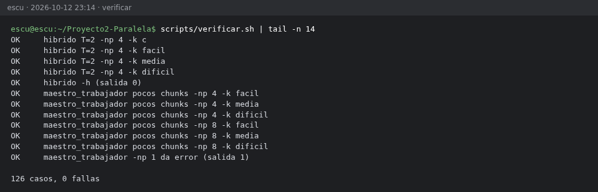
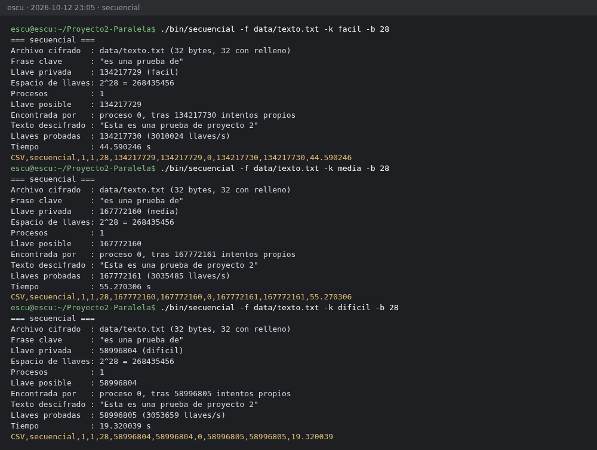
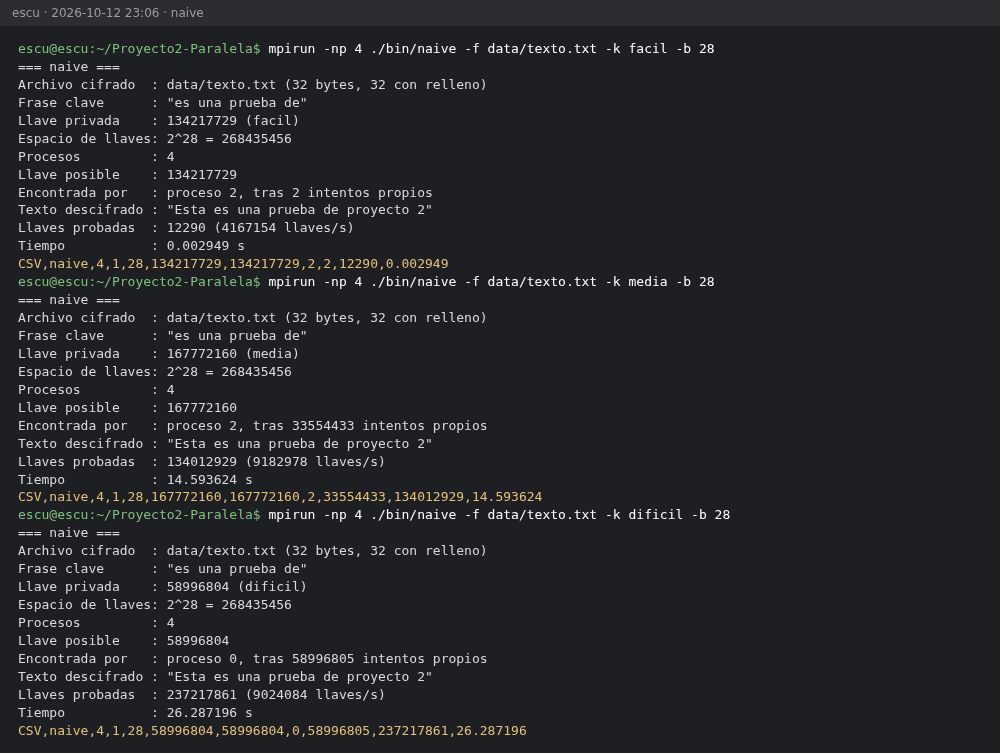
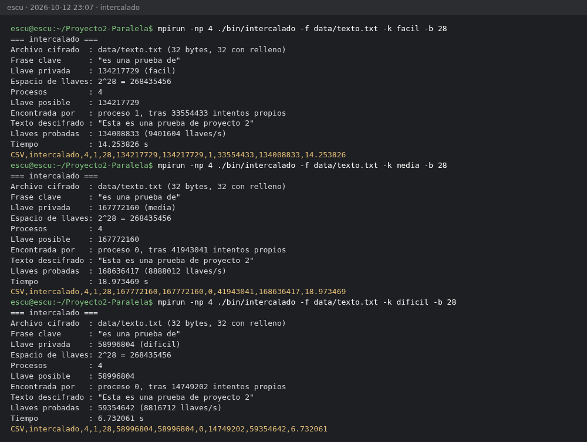
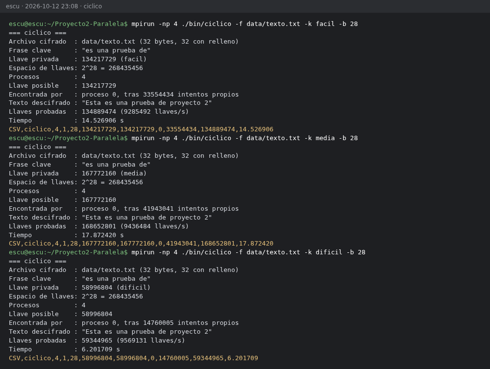
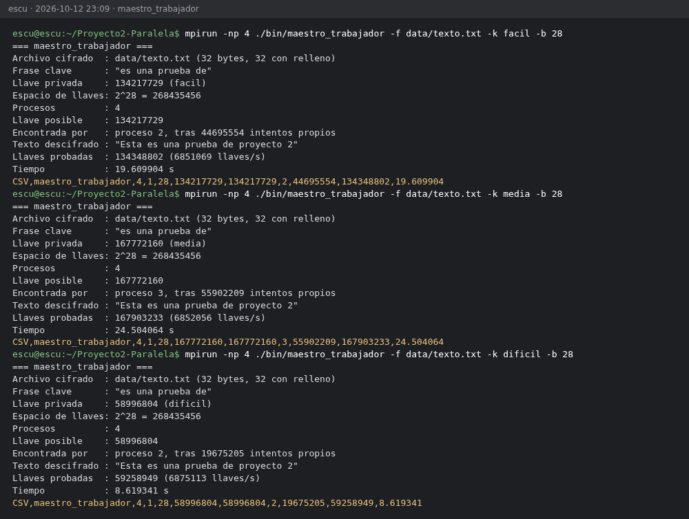
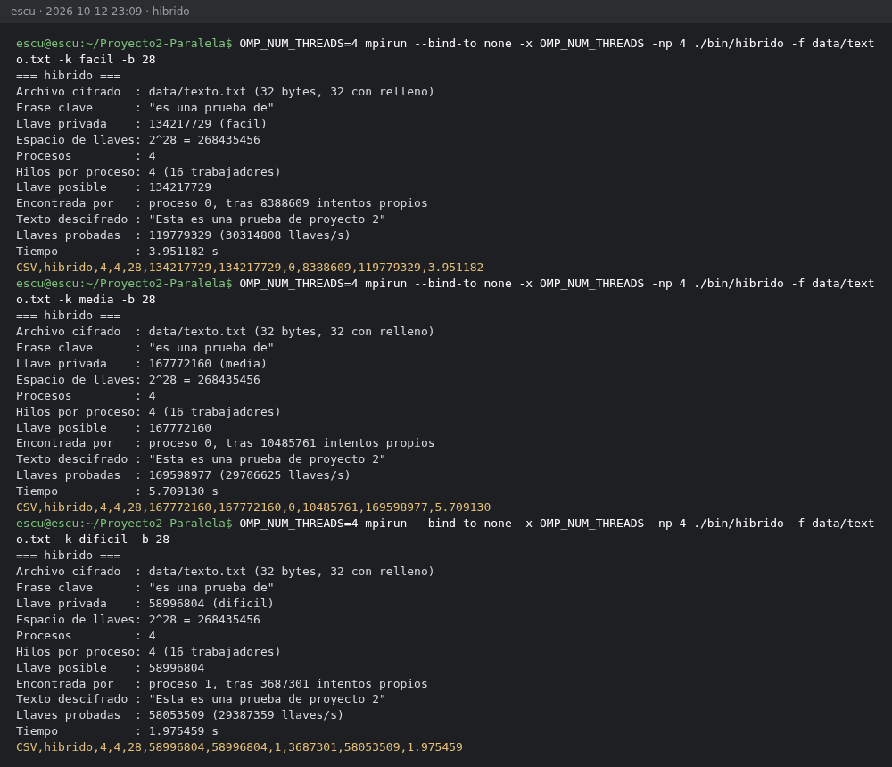
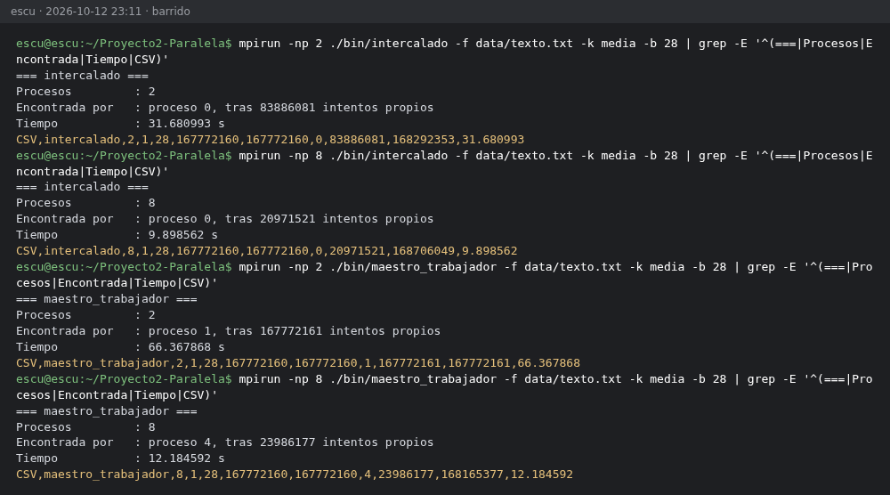

# Anexo 2: Bitácora de pruebas y speedups

## Máquina y software

Todas las mediciones de este anexo, la Parte A.3 y el análisis de speedup se tomaron en la
laptop de Esteban, que es la máquina oficial del informe. Las pruebas B.1 y B.2 se hicieron en la
MacBook Pro de Nico, como se indica en su capítulo. La tabla describe la máquina oficial.

| Componente | Detalle |
|---|---|
| CPU | Intel Core i9-13980HX: 24 núcleos (8 de rendimiento con *hyperthreading* y 16 de eficiencia), 32 hilos |
| Memoria | 16 GB |
| Sistema | CachyOS (Linux 7.2.9) |
| Compilador | GCC 16.2.1 con `-O2 -march=native -std=c11`, las mismas banderas en todos los programas |
| MPI y librerías | Open MPI 5.0.11, OpenSSL 3.6.5 y el OpenMP de GCC |

La ficha completa, con la salida de `lscpu` y la versión de `mpirun`, queda en
`resultados/maquina_escu.txt`.

## Procedimiento

La campaña se corrió con los comandos siguientes, en este orden.

```bash
make clean && make
scripts/verificar.sh                                  # 126 casos, 0 fallas
OUT=resultados/secuencial_longitudes_escu.csv REPS=5 scripts/medir_longitudes.sh   # Parte A.3
BITS=28 REPS=5 NP=4 NP_LIST="2 4 8" HYBRID_THREADS="1 2 4" scripts/campana.sh
python3 scripts/analizar.py resultados/campana_escu_<fecha>.csv
python3 scripts/capturas.py                           # capturas de este anexo
```

Se usaron 28 bits, es decir, N = 2^28 = 268 435 456 llaves. Los presets escalan con N, así que
cada llave conserva la posición relativa que tiene con 56 bits. La llave fácil vale
N/2 + 1 = 134 217 729, la media N/2 + N/8 = 167 772 160 y la difícil ⌈N/7 + N/13⌉ = 58 996 804.

Cada caso se repitió 5 veces y se reporta la mediana, junto con el mínimo y el máximo. El tiempo
es de pared. En los programas MPI se mide con `MPI_Wtime` desde la barrera hasta que llega el
aviso, y en el secuencial con `clock_gettime(CLOCK_MONOTONIC)` alrededor de la búsqueda. T_s es la
mediana del programa `secuencial` con la misma llave y los mismos bits, no el paralelo con un
proceso. El híbrido se lanzó con `mpirun --bind-to none -x OMP_NUM_THREADS -np 4` y 1, 2 y 4
hilos.

## Verificación

El script `scripts/verificar.sh` usa `-b 20` y corre cada programa con las 6 llaves (a, b, c,
fácil, media y difícil) y con 2, 3 y 4 procesos. El híbrido se prueba además con 1 y 2 hilos. El
maestro-trabajador se prueba con pocos chunks (`-b 18`), que se agotan antes de hallar la llave,
y con un solo proceso, donde debe dar error sin colgarse. El resultado fue de 126 casos y 0
fallas, como muestra la figura 14.



Figura 14. Final de la salida de `scripts/verificar.sh`, con los últimos casos y el resumen.

## Pruebas B.1 y B.2

Las corridas del cifrado con la llave 42 y las pruebas a, b y c del naive con `-np 4` están en el
capítulo de pruebas B, con sus capturas y el archivo `resultados/pruebas_b2.csv`. La prueba a da
S ≈ 0.9 como mediana de 5 corridas. La b no termina con 56 bits, pues tomaría unos 149 años en
secuencial, y con 28 bits da S = 0.96. La c la halla el proceso 1 al primer intento, con un S
aparente de unos 3.9·10^12 con 56 bits.

## Campaña: tiempos (mediana de 5, en segundos)

La campaña tuvo 140 corridas y las 140 hallaron la llave real. El mínimo y el máximo de cada caso
están en `resultados/analisis_escu.md`.

| Programa | p | h | fácil | media | difícil |
|---|---|---|---|---|---|
| secuencial (T_s) | 1 | 1 | 44.792 | 56.569 | 20.127 |
| naive | 4 | 1 | 0.004 | 14.326 | 25.321 |
| intercalado | 4 | 1 | 14.040 | 17.414 | 6.136 |
| ciclico (C = 2^16) | 4 | 1 | 13.942 | 17.645 | 6.152 |
| maestro_trabajador (C = 2^16) | 4 | 1 | 19.472 | 24.362 | 8.563 |
| hibrido | 4 | 1 | 13.499 | 16.783 | 6.009 |
| hibrido | 4 | 2 | 7.868 | 9.842 | 3.404 |
| hibrido | 4 | 4 | 4.044 | 5.801 | 2.029 |

## Speedups (S = T_s / T_p)

| Programa | w | fácil | media | difícil | E (media) |
|---|---|---|---|---|---|
| naive | 4 | 11 087 (aparente) | 3.95 | 0.79 | 0.99 |
| intercalado | 4 | 3.19 | 3.25 | 3.28 | 0.81 |
| ciclico | 4 | 3.21 | 3.21 | 3.27 | 0.80 |
| maestro_trabajador | 4 | 2.30 | 2.32 | 2.35 | 0.58 |
| hibrido, 1 hilo | 4 | 3.32 | 3.37 | 3.35 | 0.84 |
| hibrido, 2 hilos | 8 | 5.69 | 5.75 | 5.91 | 0.72 |
| hibrido, 4 hilos | 16 | 11.08 | 9.75 | 9.92 | 0.61 |

El análisis no levantó ninguna alerta. Ningún enfoque alternativo da S > w y ningún programa da
S_rend > w.

## Barrido de procesos (llave media)

| Programa | p = 2 | p = 4 | p = 8 |
|---|---|---|---|
| intercalado: T_p (s) / S | 32.565 / 1.74 | 17.414 / 3.25 | 11.301 / 5.01 |
| maestro_trabajador: T_p (s) / S | 67.133 / 0.84 | 24.362 / 2.32 | 13.477 / 4.20 |

## Capturas

Cada captura muestra la salida real de los comandos, tal como la imprimen los programas. Se
tomaron con `scripts/capturas.py` en la misma máquina, después de la campaña. Los tiempos de una
corrida suelta varían unas décimas respecto a la mediana.



Figura 15. Secuencial con las llaves fácil, media y difícil; estas corridas dan el T_s.



Figura 16. Naive con 4 procesos. Con la llave fácil, el proceso 2 la halla al segundo intento;
con la media, a la mitad de su bloque; con la difícil, el proceso 0 la halla con las mismas
iteraciones que el secuencial.



Figura 17. Intercalado con 4 procesos y las tres llaves.



Figura 18. Bloque-cíclico con 4 procesos y chunks de 2^16 llaves.



Figura 19. Maestro-trabajador con 4 procesos, es decir, un maestro y tres trabajadores.



Figura 20. Híbrido con 4 procesos y 4 hilos por proceso.



Figura 21. Barrido de procesos: intercalado y maestro-trabajador con 2 y 8 procesos. Solo se
muestran las líneas clave de cada reporte.
