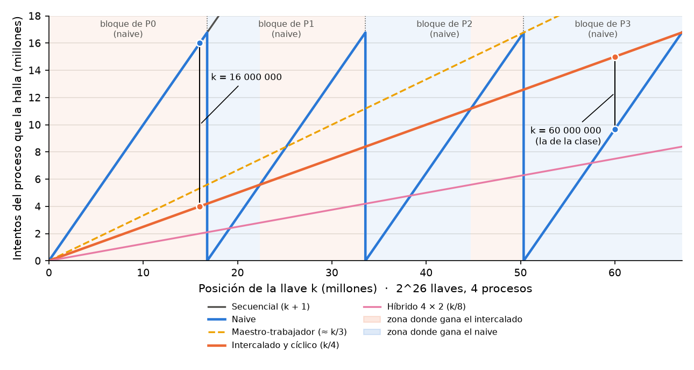
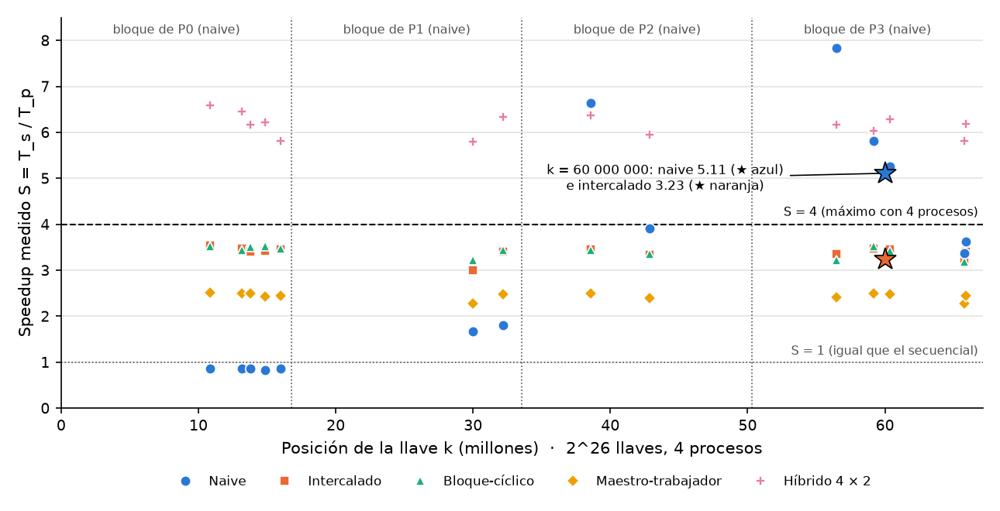

# Análisis de speedup y del comportamiento según la llave

Los números de este capítulo salen de la campaña en la laptop de Esteban (i9-13980HX), la
máquina oficial del informe, con 28 bits, 5 repeticiones por caso y la mediana de cada caso. El
detalle está en el Anexo 2 y en `resultados/analisis_escu.md`.

Las fórmulas son las del curso (Barlas, 2015; Pacheco, 2011). El speedup es S = T_s / T_p, la
eficiencia E = S / w, el costo C = w · T_p y la efectividad F = S / C, con w = p · h
trabajadores. T_s es siempre el programa `secuencial` con la misma llave y los mismos bits.
Además se usan dos speedups auxiliares: el de iteraciones, S_iter = (k + 1) / (iteraciones del
que la halla), que solo depende del reparto, y el de rendimiento, S_rend, que compara llaves
probadas por segundo y solo depende del hardware.

## Lo teórico frente a lo medido

La tabla pone, para cada llave, el S_iter que predice el resumen teórico del capítulo de enfoques
junto al speedup medido con `-np 4`.

| Llave (28 bits) | | Naive | Intercalado | Bloque-cíclico | Maestro-trabajador |
|---|---|---|---|---|---|
| fácil · k = 134 217 729 | S_iter (teoría) | 6.7·10^7 | 4 | 4 | 3 |
| | S medido | 11 087 (aparente) | 3.19 | 3.21 | 2.30 |
| media · k = 167 772 160 | S_iter (teoría) | 5 | 4 | 4 | 3 |
| | S medido | 3.95 | 3.25 | 3.21 | 2.32 |
| difícil · k = 58 996 804 | S_iter (teoría) | 1 | 4 | 4 | 3 |
| | S medido | 0.79 | 3.28 | 3.27 | 2.35 |

En todas las corridas, las iteraciones del proceso que halló la llave coinciden exactamente con
las fórmulas: el reparto prueba las llaves que debe. La diferencia entre S_iter y el S medido es,
entonces, pura pérdida de velocidad por llave, que se analiza en las fugas de eficiencia. La
figura 11 muestra los speedups medidos.

Figura 11. Speedup de cada programa por llave con 4 procesos. La barra del naive con la llave
fácil está recortada.

## El naive depende de la llave y su superlineal es aparente

Con los mismos 4 procesos, el speedup del naive va de 0.79 a 11 000. La llave fácil es la segunda
del bloque del proceso 2, que la halla en 2 intentos y 4 ms, casi todo arranque; con 56 bits el
speedup sería del orden de 10^16. La media cae a la mitad del bloque del proceso 2: la teoría da
5 y se midieron 3.95, porque cada uno de los 4 procesos activos va al 79 % del ritmo del
secuencial (5 × 0.79 ≈ 3.95). La difícil cae en el bloque del proceso 0, que hace las mismas
iteraciones que el secuencial: S = 0.79, cuatro procesos tardan más que uno.

En cambio, el intercalado da de 3.19 a 3.28 en las tres llaves y el bloque-cíclico de 3.21 a
3.27, una variación menor al 3 %. El maestro-trabajador da de 2.30 a 2.35, también parejo; con 3
trabajadores su techo es 3, y respecto a ese techo su eficiencia es 2.32 / 3 = 0.77, igual a la de
los otros.

El S > p del naive no es superlinealidad real, por tres razones. Primero, el naive no prueba
llaves más rápido: S_rend nunca supera w en toda la campaña (máximo 3.37 con w = 4 y 10.05 con
w = 16), y en el naive con la llave media vale 3.16; el proceso 2 solo tuvo que recorrer 1/8 del
espacio. Segundo, es el efecto de búsqueda del ejercicio 9 de la clase; las otras dos causas no
aplican, porque el cifrado de 32 bytes cabe en caché en ambos casos y no hay sobrecarga que se
reduzca al partir el problema. Tercero, en promedio el efecto desaparece: como se vio en el
resumen teórico, E[T_p] = N/(2p) en el naive y en el intercalado. Ningún enfoque alternativo
superó S = w, y el análisis automático, que marca cualquier S o S_rend mayor que w, no levantó
alertas.

## La llave 60 000 000: por qué fue un mal ejemplo para comparar

En la comparación que presentamos en clase usamos una sola llave, k = 60 000 000 con 26 bits y
`-np 4`, y el naive tardó menos que el intercalado. No es un error del código: es la llave la que
decide quién gana. Con 4 núcleos ocupados, cada proceso prueba cerca de 2.5 millones de llaves
por segundo en todos los programas, así que gana el que necesita menos intentos según las
fórmulas del resumen teórico.

Con 26 bits, N = 67 108 864 y cada bloque del naive mide N/4 = 16 777 216. La llave cae en el
último cuarto del espacio.

| Programa | Proceso que la halla | Intentos | Tiempo medido | Speedup |
|---|---|---|---|---|
| Secuencial | 0 | 60 000 001 | 18.97 s | 1.00 |
| Naive | 3 | 9 668 353 | 3.71 s | 5.11 |
| Intercalado | 0 | 15 000 001 | 5.87 s | 3.23 |

El proceso 3 del naive empieza en 3N/4 = 50 331 648 y solo recorre 9 668 353 llaves. En el
intercalado, la llave le toca al proceso 0 (60 000 000 mod 4 = 0), que antes tiene que probar sus
15 000 000 llaves menores. La razón de intentos es 15 000 001 / 9 668 353 = 1.55 y la de tiempos
5.87 / 3.71 = 1.58: la diferencia sale entera del número de intentos, no de que el intercalado
pruebe llaves más despacio. El speedup de 5.11 con 4 procesos es la señal de alarma: el proceso 3
se saltó, por su posición, las 50 millones de llaves que el secuencial sí probó.

Para cualquier llave del último cuarto, k = 3N/4 + r con 0 ≤ r < N/4, el naive necesita r + 1
intentos y el intercalado 3N/16 + r/4 + 1. El naive gana si r < 3N/16 + r/4, es decir, si
r < N/4, lo que siempre se cumple: en todo el último cuarto el naive le gana al intercalado.

La figura 12 dibuja las fórmulas para todas las llaves. El naive es un serrucho, porque cada
proceso empieza su bloque desde cero: la llave cuesta poco al inicio de un bloque y mucho al
final. El intercalado es una recta k/4 que sube pareja. Las rectas se cruzan y, como muestra el
fondo, cada uno gana en la mitad del espacio. Las líneas verticales marcan la llave de la clase,
donde el naive queda abajo, y una llave del primer cuarto, donde el naive coincide con el
secuencial y el intercalado necesita la cuarta parte.

Figura 12. Intentos que necesita el proceso que halla la llave, según dónde cae, con 2^26 llaves
y 4 procesos. El fondo azul marca dónde gana el naive y el naranja dónde gana el intercalado.

### Con qué llaves había que comparar

Una sola llave no compara algoritmos, compara posiciones. Lo justo es correr todos los programas
con las mismas llaves, pero con varias que cubran el espacio, y comparar el promedio y cuánto
varía. Con 26 bits y `-np 4`, la mitad de cada cuarto basta para verlo:

| Llave | Dónde cae | Intentos del naive | Intentos del intercalado | Gana |
|---|---|---|---|---|
| 8 388 608 | mitad del 1.er cuarto | 8 388 609 | 2 097 153 | intercalado (4 veces) |
| 25 165 824 | mitad del 2.º cuarto | 8 388 609 | 6 291 457 | intercalado |
| 41 943 040 | mitad del 3.er cuarto | 8 388 609 | 10 485 761 | naive |
| 58 720 256 | mitad del 4.º cuarto | 8 388 609 | 14 680 065 | naive |
| Promedio | | 8 388 609 | 8 388 609 | empate |

Cada uno gana en la mitad de los casos y en promedio empatan; sobre todas las llaves posibles, el
naive gana en exactamente el 50 %. Los presets b y c del enunciado son los extremos: con
b = N/4 − 1, el proceso 0 del naive recorre todo su bloque, igual que el secuencial, contra la
cuarta parte en el intercalado; con c = N/4, el proceso 1 del naive la halla en un intento. Un
contraejemplo medido, k = 16 000 000: el intercalado tardó 1.70 s y el naive 6.86 s, más que el
propio secuencial.

### Prueba con 16 llaves al azar

Para no depender de una posición, se corrieron todos los programas con las mismas 16 llaves al
azar de 26 bits (`resultados/campana_escu_20261014-2308.csv`). El rango de speedup excluye las dos
llaves menores de 2 millones, donde el arranque pesa más que la búsqueda.

| Programa | Promedio | Mínimo – máximo | Speedup medio | Speedup mínimo – máximo |
|---|---|---|---|---|
| Secuencial | 11.21 s | 0.11 – 22.98 s | 1.00 | — |
| Maestro-trabajador | 4.62 s | 0.03 – 9.38 s | 2.58 | 2.27 – 2.51 |
| Naive | 4.34 s | 0.13 – 6.40 s | 2.87 | 0.83 – 7.83 |
| Intercalado | 3.33 s | 0.03 – 6.76 s | 3.42 | 3.00 – 3.53 |
| Bloque-cíclico | 3.32 s | 0.03 – 6.78 s | 3.44 | — |
| Híbrido, 1 hilo | 3.28 s | 0.03 – 6.69 s | 3.48 | — |
| Híbrido, 2 hilos | 1.83 s | 0.01 – 3.71 s | 6.29 | — |

El naive le ganó al intercalado en 7 de las 16 llaves, todas del tercer o del último cuarto, y fue
más lento que el secuencial en otras 7, todas del primer cuarto. Su promedio salió algo peor que
el del intercalado porque la muestra trajo 7 llaves del primer cuarto en vez de las 4 esperadas;
con llaves uniformes, ambos promedian lo mismo.

La figura 13 muestra esas corridas. Los puntos del naive caen donde dice la figura 12: cerca de 1
en el bloque de P0, alrededor de 1.7 en el de P1 y entre 3.4 y 7.8 en los dos últimos, varias
veces por encima del máximo de 4. Los del intercalado y el bloque-cíclico forman una franja pareja
cerca de 3.4, los del maestro-trabajador otra cerca de 2.4 y los del híbrido, con el doble de
trabajadores, otra cerca de 6.2. Las estrellas son la llave 60 000 000 de la clase.

Figura 13. Speedup medido de cada programa con las 16 llaves al azar de 26 bits y 4 procesos
(el híbrido con 2 hilos por proceso), según dónde cae la llave.

El intercalado no es mejor porque gane con cada llave, sino porque su speedup no depende de la
suerte: queda entre 3.0 y 3.5 con cualquier llave, mientras el del naive va de 0.83 a 7.83.
Ningún reparto estático le gana al naive con todas las llaves, porque todos prueban p llaves por
paso y el promedio N/(2p) ya es el mínimo posible; para mejorarlo siempre hay que probar más
llaves por segundo, como el híbrido con 8 trabajadores. El maestro-trabajador queda segundo peor
porque con `-np 4` solo buscan 3 procesos.

## Fugas de eficiencia

Con `-np 4`, el intercalado tiene E ≈ 0.81 y S_rend ≈ S (3.26 frente a 3.25): no se desperdician
llaves, sino que cada proceso prueba llaves más despacio que el secuencial solo. La tabla ubica
cada fuga en nuestro problema.

| Fuga | En nuestro problema |
|---|---|
| Parte secuencial (η_f) | Leer, cifrar y difundir el texto toma milisegundos. En el maestro-trabajador pesa el maestro entero, 1/p del cómputo |
| Comunicación (η_c) | Un `MPI_Test` cada 4096 llaves y un aviso al final: despreciable. En el maestro-trabajador, un pedido por chunk, oculto en parte por el pedido adelantado |
| Desbalance (η_b) | Nulo en los repartos estáticos, porque todos reciben N/p llaves; en el bloque-cíclico, como mucho un chunk. En el naive, respecto a la llave: p − 1 procesos trabajan donde no está |
| Redundancia (η_r) | Ninguna: cada llave se prueba una sola vez |
| Hardware | La que domina. Con un núcleo activo el i9 sube al turbo máximo; con 4 u 8 baja la frecuencia, y pasados 8 trabajadores se comparten núcleos por *hyperthreading* o entran los de eficiencia |

## Barrido de procesos, Amdahl y Gustafson

La tabla resume el barrido con la llave media. La figura 14 lo compara con la recta ideal y con la
curva de Amdahl.

| Programa | p | T_p (s) | S | E | C (s) | F |
|---|---|---|---|---|---|---|
| secuencial | 1 | 56.57 | 1.00 | 1.00 | 56.57 | 0.018 |
| intercalado | 2 | 32.57 | 1.74 | 0.87 | 65.13 | 0.027 |
| intercalado | 4 | 17.41 | 3.25 | 0.81 | 69.65 | 0.047 |
| intercalado | 8 | 11.30 | 5.01 | 0.63 | 90.40 | 0.055 |
| maestro-trabajador | 2 | 67.13 | 0.84 | 0.42 | 134.27 | 0.006 |
| maestro-trabajador | 4 | 24.36 | 2.32 | 0.58 | 97.45 | 0.024 |
| maestro-trabajador | 8 | 13.48 | 4.20 | 0.52 | 107.82 | 0.039 |

Figura 14. Speedup contra número de procesos con la llave media, con la recta ideal y la curva
de Amdahl de cada programa.

Para Amdahl se toma el intercalado con p = 4: f_p = (1 − 1/3.25) / (1 − 1/4) = 0.923, así que
f_s = 0.077 y el techo 1/f_s ronda 13. Con esa fracción, Amdahl predice 5.20 para p = 8 y se
midieron 5.01, un 3.7 % menos; para p = 2 predice 1.86 y se midieron 1.74. Esa f_s no es código
secuencial: es la pérdida de frecuencia al activar más núcleos, que crece con p en vez de
quedarse fija. Por eso Amdahl, calibrado en p = 4, sobrestima los extremos.

El maestro-trabajador no sigue a Amdahl, porque su pérdida es estructural: con p procesos tiene
p − 1 trabajadores. Con p = 2 hay uno solo y es más lento que el secuencial (S = 0.84); con p = 8
el maestro pesa 1/8 y el speedup sube a 4.20, muy por encima de los 2.98 que predice Amdahl con la
f_s de p = 4.

La ley de Gustafson describe mejor la fuerza bruta, porque el problema crece solo: con S ≈ 3.25
se cubren 3.25 veces más llaves en el mismo tiempo, es decir, log2(3.25) ≈ 1.7 bits más, y con el
híbrido de 16 trabajadores (S ≈ 10) unos 3.3 bits más. Al ritmo medido del secuencial, unos
2.97·10^6 llaves por segundo, recorrer las 2^56 llaves tomaría unos 770 años; el intercalado con
4 procesos lo bajaría a unos 237 y el híbrido de 16 trabajadores a unos 79. Hacerlo en un día
exigiría unos 281 000 núcleos con eficiencia 1.

La efectividad sigue creciendo hasta el p más grande que se midió: 0.055 con 8 procesos en el
intercalado y 0.105 con el híbrido de 16 trabajadores. Todavía conviene agregar trabajadores,
aunque la eficiencia baje de 0.87 a 0.63; si se exige una eficiencia de al menos 0.8, el punto
adecuado es p = 4.

## El híbrido frente a la versión sin OpenMP

La tabla da el speedup y la eficiencia del híbrido con 4 procesos y 1, 2 y 4 hilos por proceso.
La figura 15 muestra el tiempo y el speedup contra los hilos.

| Llave | h = 1 (w = 4) | h = 2 (w = 8) | h = 4 (w = 16) |
|---|---|---|---|
| fácil | S = 3.32 · E = 0.83 | S = 5.69 · E = 0.71 | S = 11.08 · E = 0.69 |
| media | S = 3.37 · E = 0.84 | S = 5.75 · E = 0.72 | S = 9.75 · E = 0.61 |
| difícil | S = 3.35 · E = 0.84 | S = 5.91 · E = 0.74 | S = 9.92 · E = 0.62 |

Figura 15. Tiempo y speedup del híbrido con 4 procesos según los hilos por proceso.

Con un hilo, el híbrido es el intercalado y tarda entre 0.96 y 0.98 veces lo mismo (13.50 s
frente a 14.04 s con la llave fácil, 16.78 frente a 17.41 con la media y 6.01 frente a 6.14 con la
difícil). Con más hilos, el tiempo baja de forma pareja en las tres llaves: el speedup ronda 5.7 a
5.9 con 2 hilos y 9.8 a 11.1 con 4, con S_iter exactamente 8 y 16 y S_rend sin superar w. Frente a
`intercalado -np 8`, con los mismos 8 trabajadores pero todos MPI, el híbrido de 4 procesos con 2
hilos tarda 9.84 s contra 11.30 s, porque los hilos comparten el proceso y no hay ocho procesos
sondeando MPI.

La eficiencia baja con 16 trabajadores porque el i9 tiene 8 núcleos de rendimiento: pasados 8
trabajadores, los demás comparten núcleo por *hyperthreading* o caen en núcleos de eficiencia, y
como el reparto es estático, todos esperan al más lento. Aun así, el speedup crece de forma
consistente con w.
