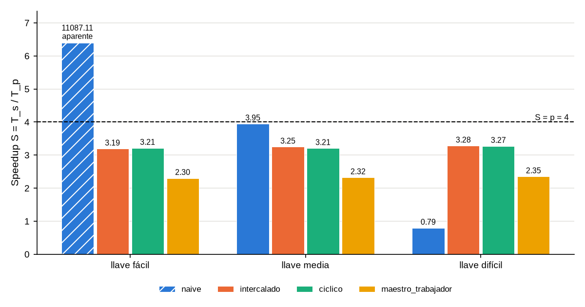
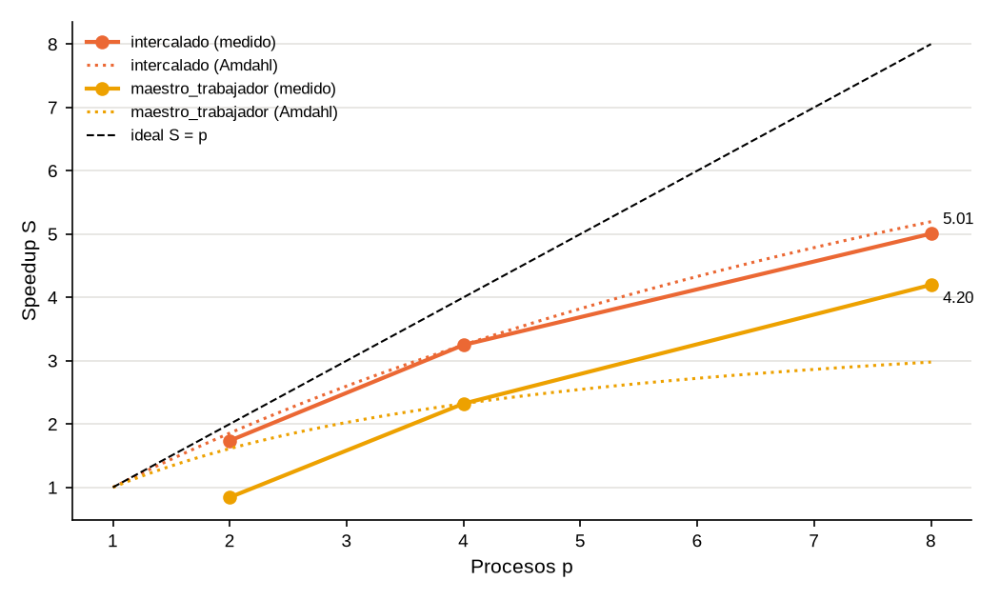
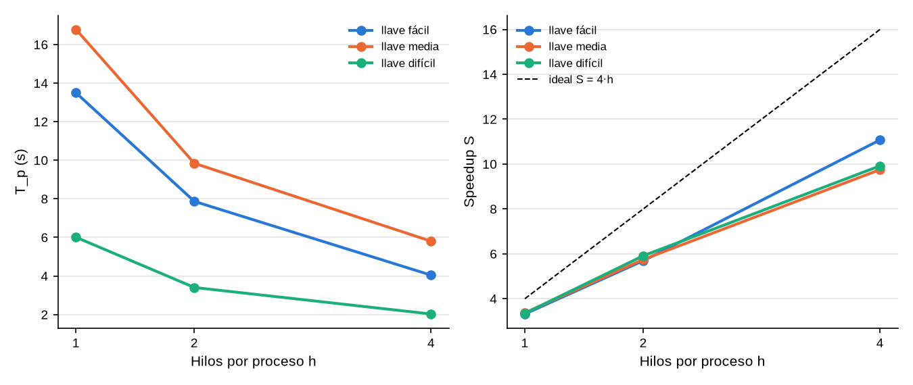

# Análisis de speedup y del comportamiento según la llave

Los números de este capítulo salen de la campaña **preliminar** (i9-13980HX, 28 bits, 5
repeticiones, mediana; detalle en el Anexo 2 y en `resultados/analisis_escu.md`). Las fórmulas
son las del curso: S = T_s / T_p, E = S / w, C = w · T_p, F = S / C, con w = p · h trabajadores
(Barlas, 2015; Pacheco, 2011). T_s es siempre el programa `secuencial` con la misma llave y los
mismos bits.

## 1. Lo teórico frente a lo medido

| Llave (28 bits) | | Naive | Intercalado | Bloque-cíclico | Maestro-trabajador |
|---|---|---|---|---|---|
| fácil · k = 134 217 729 | S_iter (teoría) | 6.7·10^7 | 4 | 4 | 3 |
| | S medido | 11 087 (aparente) | 3.19 | 3.21 | 2.30 |
| media · k = 167 772 160 | S_iter (teoría) | 5 | 4 | 4 | 3 |
| | S medido | 3.95 | 3.25 | 3.21 | 2.32 |
| difícil · k = 58 996 804 | S_iter (teoría) | 1 | 4 | 4 | 3 |
| | S medido | 0.79 | 3.28 | 3.27 | 2.35 |

S_iter, que solo cuenta iteraciones, coincide **exactamente** con la teoría del capítulo de
enfoques en todas las corridas: el reparto prueba las llaves que debe y quien halla la llave lo
hace en el número de intentos previsto. La diferencia entre S_iter y el S medido es, entonces,
pura pérdida de velocidad por llave (sección 4).

## 2. Por qué el naive es inconsistente

El tiempo del naive no depende de cuántas llaves hay, sino de **dónde cae la llave dentro del
bloque del proceso que la tiene**. Con las mismas 4 llaves de proceso:

- **Fácil:** k = N/2 + 1 es la segunda llave del bloque del proceso 2. La halla en 2 intentos,
  4 ms (casi todo es arranque y la primera ronda de sondeo), y el secuencial tarda 44.8 s:
  **S ≈ 11 000**. Con 56 bits sería ≈ 10^16.
- **Media:** k = N/2 + N/8 cae a la mitad del bloque del proceso 2, que recorre N/8 llaves:
  S_iter = 5. Medido, **S = 3.95**: los 4 procesos activos van cada uno al 79 % del ritmo del
  secuencial, y 5 × 0.79 ≈ 3.95.
- **Difícil:** k ≈ 0.22 N cae en el bloque del proceso 0, que hace las mismas k + 1 iteraciones
  que el secuencial: S_iter = 1 y medido **S = 0.79**. Es el peor caso: cuatro procesos, más
  lento que uno.

Entre llaves, el speedup del naive va de 0.79 a 11 000. Con las pruebas del enunciado (capítulo
de pruebas B) pasa lo mismo: b y c son vecinas y una da S ≈ 1 y la otra S ≈ 10^12.

## 3. Por qué las alternativas son consistentes

El intercalado da S = 3.19–3.28 y el bloque-cíclico 3.21–3.27 en las tres llaves: una variación
menor al 3 %, frente a cuatro órdenes de magnitud del naive. El maestro-trabajador da 2.30–2.35,
también parejo, por debajo de los otros porque **el maestro no busca**: con 3 trabajadores su
techo es 3, y respecto a ese techo su eficiencia es 2.32 / 3 = 0.77, igual a la de los otros.

En todos ellos el que halla la llave hace ⌊k/p⌋ + 1 iteraciones (o el equivalente por chunks),
así que S ≈ p sin importar dónde esté la llave.

## 4. El superlineal: aparente, nunca real

En esta campaña ningún programa alternativo superó S = w, y el análisis automático no levantó
ninguna alerta. El único S > p es el del naive con la llave fácil, y es **aparente**:

1. **No procesa llaves más rápido.** El speedup de rendimiento,
   S_rend = (llaves probadas / T_p) / ((k + 1) / T_s), compara llaves por segundo. Su máximo en
   toda la campaña es 3.37 con w = 4 (híbrido con 1 hilo) y 10.05 con w = 16: **siempre
   S_rend ≤ w**. En el naive con la llave media, S_rend = 3.16: el proceso 2 simplemente tuvo
   que recorrer 1/8 del espacio, no lo recorrió más rápido.
2. **Es el efecto de búsqueda** (ejercicio 9 de la clase): la llave queda al inicio de un bloque
   que no es el primero. De las tres causas de superlinealidad vistas en clase, la de caché no
   aplica (el cifrado mide 32 bytes y cabe en caché en ambos casos) y tampoco hay sobrecarga que
   se reduzca al partir.
3. **En promedio no existe.** Si la llave es uniforme en [0, N), el proceso que la tiene recorre
   en promedio la mitad de N/p llaves: E[T_p] = N/(2p) contra E[T_s] = N/2, así que el speedup
   esperado del naive es p, igual que el del intercalado. Las llaves que le dan S ≫ p se
   compensan con las que le dan S = 1.

Si un enfoque alternativo diera S > p habría que revisar, en este orden: T_s de otra llave o de
otros bits, banderas de compilación distintas, el secuencial medido con la máquina ocupada, un
reparto que se salta llaves (S_iter distinto a la teoría) o T_p medido después del aviso.

## 5. Fugas de eficiencia

Con -np 4, el intercalado tiene E ≈ 0.81 y además S_rend ≈ S (3.26 frente a 3.25): no se
desperdician llaves, cada proceso prueba llaves más despacio que el secuencial solo. Eso ubica
la pérdida:

| Fuga | En nuestro problema |
|---|---|
| η_f parte secuencial | Leer, cifrar y difundir el texto: milisegundos. En el maestro-trabajador, el maestro entero (1/p del cómputo) |
| η_c comunicación | Un `MPI_Test` cada 4096 llaves y un aviso al final: despreciable. En el maestro-trabajador, un pedido por chunk, oculto en parte por el pedido adelantado |
| η_b desbalance | Nulo en los repartos estáticos (todos reciben N/p llaves). En el naive, respecto a la llave: p − 1 procesos trabajan donde no está |
| η_r redundancia | Ninguna: cada llave se prueba una sola vez |
| Hardware | **La que domina.** Con 1 núcleo activo el i9 sube al turbo máximo; con 4 u 8 baja la frecuencia, y pasados 8 trabajadores se comparten núcleos (*hyperthreading*) o entran los de eficiencia |

## 6. Barrido de procesos, Amdahl y efectividad

| Programa | p | T_p (s) | S | E | C (s) | F |
|---|---|---|---|---|---|---|
| secuencial | 1 | 56.57 | 1.00 | 1.00 | 56.57 | 0.018 |
| intercalado | 2 | 32.57 | 1.74 | 0.87 | 65.13 | 0.027 |
| intercalado | 4 | 17.41 | 3.25 | 0.81 | 69.65 | 0.047 |
| intercalado | 8 | 11.30 | 5.01 | 0.63 | 90.40 | 0.055 |
| maestro-trabajador | 2 | 67.13 | 0.84 | 0.42 | 134.27 | 0.006 |
| maestro-trabajador | 4 | 24.36 | 2.32 | 0.58 | 97.45 | 0.024 |
| maestro-trabajador | 8 | 13.48 | 4.20 | 0.52 | 107.82 | 0.039 |

**Amdahl.** Con el intercalado en p = 4: f_p = (1 − 1/3.25) / (1 − 1/4) = **0.923**, f_s = 0.077
y techo 1/f_s ≈ **13**. La predicción para p = 8 es 1/(0.077 + 0.923/8) = 5.20, y se midió 5.01
(−3.7 %); para p = 2 predice 1.86 y se midió 1.74. Esa «f_s» no es código secuencial: es la
pérdida de frecuencia al activar más núcleos, que crece con p en vez de quedarse fija. Por eso
Amdahl, calibrado en p = 4, sobrestima los extremos.

El maestro-trabajador no sigue a Amdahl porque su pérdida es estructural: con p procesos tiene
p − 1 trabajadores. Con p = 2 hay uno solo y es más lento que el secuencial (S = 0.84); con
p = 8 la fracción del maestro baja a 1/8 y S sube a 4.20, muy por encima de los 2.98 que predice
Amdahl con la f_s de p = 4. Su ideal es S = p − 1, y E → 1 cuando p crece.

**Gustafson.** En fuerza bruta el problema crece solo: con S ≈ 3.25 se cubren 3.25 veces más
llaves en el mismo tiempo, log2(3.25) ≈ **1.7 bits más**; con el híbrido de 16 trabajadores
(S ≈ 10) son ≈ 3.3 bits más. Con f_s ≈ 0, el speedup escalado de Gustafson tiende a p.

**Efectividad.** F sigue creciendo hasta el p más grande medido (0.055 con 8 procesos en el
intercalado y 0.105 con el híbrido de 16 trabajadores): todavía conviene agregar trabajadores,
aunque la eficiencia baja de 0.87 a 0.63. Si se exige E ≥ 0.8, el punto es p = 4.

## 7. El híbrido: speedup consistente con y sin OpenMP

| Llave | h = 1 (w = 4) | h = 2 (w = 8) | h = 4 (w = 16) |
|---|---|---|---|
| fácil | S = 3.32 · E = 0.83 | S = 5.69 · E = 0.71 | S = 11.08 · E = 0.69 |
| media | S = 3.37 · E = 0.84 | S = 5.75 · E = 0.72 | S = 9.75 · E = 0.61 |
| difícil | S = 3.35 · E = 0.84 | S = 5.91 · E = 0.74 | S = 9.92 · E = 0.62 |

1. **Con un hilo es el intercalado:** tarda 0.96–0.98 veces lo mismo (13.50 s frente a 14.04 s
   en fácil; 16.78 frente a 17.41 en media; 6.01 frente a 6.14 en difícil).
2. **Con más hilos baja parejo en las tres llaves:** S ≈ 5.7–5.9 con 2 hilos y ≈ 9.8–11.1 con 4.
   S_iter es exactamente 8 y 16, y S_rend nunca pasa de w.
3. **Frente a `intercalado -np 8`** (los mismos 8 trabajadores, todos MPI) el híbrido 4 × 2 tarda
   9.84 s contra 11.30 s: un poco mejor, porque los hilos comparten el proceso y no hay ocho
   procesos sondeando MPI.

La eficiencia baja con 16 trabajadores porque el i9 tiene 8 núcleos de rendimiento: pasados 8
trabajadores, los demás comparten núcleo por *hyperthreading* o caen en núcleos de eficiencia,
más lentos, y el reparto estático hace que todos esperen al más lento. Aun así, el speedup crece de forma consistente con w.

## 8. De 28 a 56 bits

Al ritmo medido del secuencial, 167 772 161 llaves en 56.57 s ≈ **2.97·10^6 llaves/s**:

- T_s(2^56) = 2^56 / 2.97·10^6 ≈ 2.43·10^10 s ≈ **770 años**.
- El intercalado con 4 procesos (S = 3.25) bajaría eso a ≈ 237 años, y el híbrido de 16
  trabajadores (S ≈ 9.75) a ≈ 79 años.
- Para recorrer 2^56 llaves en un día harían falta ≈ 2.43·10^10 / 86 400 ≈ **281 000 núcleos**
  con eficiencia 1.

Como los presets escalan con N, S_iter con 28 bits es el mismo que con 56 (salvo c y fácil del
naive, que valen ≈ N/4), y por eso estas mediciones representan el problema completo.
